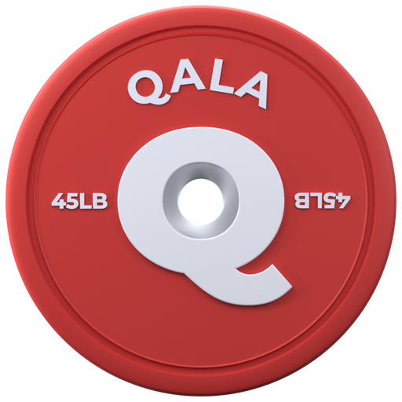

<div align="center">



# Qala

**Lift and run from one plan.**

Self-hosted adaptive training. Programs are written as LS++ text, an engine
adjusts the plan from check-ins and logged sessions, and a local coach model
explains the numbers. Runs feed the same fatigue model as lifting.

[](LICENSE)
[](#)
[](#)
[](#)
[](#)

[Quick Start](#quick-start) • [Features](#features) • [Architecture](#architecture) • [Docs](#docs) • [License](#license)

</div>

---

## Features

| Area | What it does |
|------|--------------|
| **LS++ programs** | Write training as text (`.lspp`). Format, lint, and dry-run in the editor, import and check on the server. |
| **Adaptive engine** | Check-ins and logged sets move Fitness (`F`) and Fatigue (`G`), the Kalman e1RM estimate, and the next session. |
| **Shared fatigue** | Lifting and running count toward the same model. One readiness score at session start. |
| **Coach** | A local model answers questions about the plan; the reply is validated, and the server returns a degraded state when the model is down. |
| **Import** | Paste text, upload a PDF, or dictate. The import screen proposes LS++ with a diff and a confirm step. |
| **Web and Android** | Desktop author shell and phone logger on the web; a native Kotlin and Jetpack Compose app with a Rust core via UniFFI. |

## Status

Web is v1 on sample data: the desktop author shell and the frozen phone PWA.
The native Android app is the active work, with the Rust core, the Room data
layer, Today with the day rail, check-in, the lifting loop, and the Coach screen.
Run recording, sync, and charts have not started. Everything on Android has run
on the emulator only.

The device gates (a 2 h locked-screen run, Spotify ducking, a killed service
resuming) have not run on the phone. See `docs/android-native.md` section 5.

`docs/ROADMAP.md` says where each track stands. The plan is `docs/PLAN.md`, the
design system `docs/DESIGN.md`, the decision log `docs/DECISIONS.md`.

## Quick Start

Prereqs: Deno 2, Node 22 + npm.

```sh
npm --prefix apps/web install
```

```sh
deno task build:wasm   # LS++ wasm into target/wasm-out/web; docs/rust-core.md has the one-time installs
deno task build        # typecheck + bundle the PWA into apps/web/dist
deno task test         # every package's tests; server/ needs the wasm built first
deno task dev          # server with watch on 127.0.0.1:8500, serves dist/
deno task serve        # server without watch
deno task build:android  # debug APK of apps/android; see docs/android-native.md section 11
```

The server listens on `127.0.0.1:8500` and is published on the tailnet with:

```sh
tailscale serve --bg --https=8443 http://127.0.0.1:8500
```

See `deploy/tailscale-serve.md` for the full notes.

Rust tests run through the safe runner. A bare `cargo test` can exhaust memory.

```sh
scripts/cargo-test-safe.sh -p <crate>
```

## Architecture

```
qala/
├── apps/
│   ├── web/            # React PWA: desktop author shell + phone logger shell, one theme
│   └── android/        # Native Kotlin + Jetpack Compose: app, design, data (Room + Rust build)
├── packages/
│   ├── core/           # Data model, document schema, exercise seed and overlay, units and rounding
│   ├── engine/         # Adaptive training engine, pure TypeScript
│   ├── generator/      # Rules engine that emits LS++ programs
│   ├── llm/            # Prompt builders and response validation for the coach
│   ├── liftoscript/    # liftosaur's grammars and evaluator, vendored (TS oracle and desktop authoring runtime)
│   ├── lspp/           # Typed client over the LS++ wasm build (`deno task build:wasm` makes it)
│   └── run/            # GPS pipeline and guided workout step machine, pure TypeScript
├── crates/
│   ├── qala-core/      # Pure logic: engine, availability, HLC, records, plate math
│   ├── qala-ffi/       # UniFFI for Kotlin, exports qala-core and LS++
│   ├── qala-lspp/      # Rust LS++ port
│   ├── qala-lspp-json/ # LS++ JSON layer
│   └── qala-lspp-wasm/ # LS++ wasm (web editor, server import check)
├── server/             # Deno server on 127.0.0.1:8500: sync, Tailscale-header auth, tiles and elevation, LLM proxy, text import
├── assets/             # Source fonts and the 3D icon renders (assets/3d/)
├── deploy/             # systemd unit and Tailscale notes
├── docs/               # Start at ROADMAP.md; README.md there indexes the rest
├── mockups/            # Hand-drawn review canvas. Not app code.
└── scripts/            # Wasm build, vendor, fuzz, tile and token generators
```

**Flow.** `packages/server` and the web app load the LS++ wasm client from
`packages/lspp`. The desktop editor runs checks, Format, and dry run through it;
the server runs the import check through it. Android calls the same language
through `crates/qala-ffi` and UniFFI, and runs `qala-core` for engine math.

**Choices in one line.** Off-white ground, white surfaces, 2px borders, hard
offset shadows, zero blur, 4/6/8px radii, no pills. Ember is the one action
color. Numbers are the hero, in Qala Test. Every adjusted number shows its
reason in one line. See `docs/DESIGN.md`.

## Docs

| Doc | What it is |
|-----|------------|
| `docs/ROADMAP.md` | Where each track stands and what it waits on |
| `docs/PLAN.md` | The build plan |
| `docs/DESIGN.md` | The design system and screen spec (web; native departs, see its status line) |
| `docs/DECISIONS.md` | The decision log (rows are added, never renumbered) |
| `docs/decisions-pending.md` | The queue of open choices and the protocol for deciding them |
| `docs/android-native.md` | The native Android app: platform, modules, run recorder, data layer, phases A0 to A7 |
| `docs/rust-core.md` | The Rust core: architecture, sync, porting order, spike report |
| `docs/ls-plus-plus.md` | The LS++ language, its extensions, the import pipeline |
| `docs/CONTEXT.md` | The glossary |

## License

AGPL-3.0-or-later, see [LICENSE](LICENSE). Liftoscript, the exercise seed, and
the built-in programs come from [liftosaur](https://github.com/astashov/liftosaur)
(also AGPL-3.0), credited in [NOTICE](NOTICE) along with the fonts, icons, and
chart libraries.
