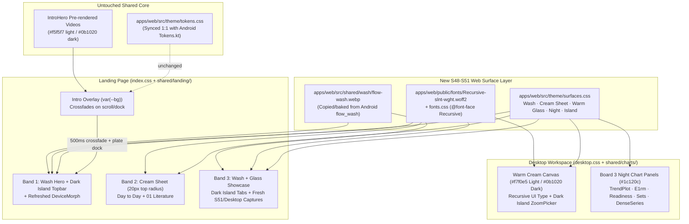

# Qala Website Redesign Plan: S48–S51 Mobile Aesthetic + Human Copy Pass

**Target executor:** Claude (execution-ready specification)  
**Target scope:** `apps/web/` (Landing Page + Desktop Workspace), fresh S51 mobile & desktop screenshots, full website copy de-AI & factual-accuracy pass, and doc updates.  
**Reference baseline:** Current Android mobile app (`apps/android/`, commits through `49a0d6c`, DECISIONS S48–S51).

---

## 1. Goal & Design Direction

Bring the website (`apps/web/`) into visual and verbal alignment with the current native Android app (S48–S51):

1. **Three-Surface Visual Architecture (S51):** Adopt Android's Warm Frosted **Wash** (`#140A04` + baked `flow_wash.webp` + umber scrims), Warm **Cream Sheet** (`#F7F0E5` @ 95% in Light / `#0B1020` @ 95% in Dark, `20px` rounded top with `2px` white top rim and upward umber shadow), and Warm Translucent **Glass** (`rgba(255,248,238,0.74)` in Light / `rgba(24,14,8,0.58)` in Dark) paired with flush **`#1C120C` Night chart panels**.
2. **Floating Dark Umber Island Chrome (S50):** Translate the phone's theme-invariant floating dark island (`rgba(22,13,8,0.92)`, `1px solid rgba(255,255,255,0.16)`, `#E0652B` active ember pill, `2px 4px 0 rgba(0,0,0,0.31)`) into the landing topbar, landing showcase tab switcher, and desktop Load Zoom picker.
3. **Unified Three-Font Typography (L4, L19):** Ship **Recursive** (`wght 300–1000, slnt -15..0`, tabular numerals by default) for UI text and body copy across both the landing page (replacing DM Mono body copy) and the desktop workspace (replacing DM Sans), keeping **Qala Test** (`700`/`500`, optional Faustina fallback) for titles and hero numerals and **DM Mono** for logs, axis ticks, citations, and LS++ code.
4. **Board 3 Chart Language on Desktop (S51):** Move desktop trend, e1RM, readiness, sets-by-muscle, and dense run charts onto `#1C120C` Night panels (`2.5px` white monotone line over `#2DD4BF` teal fade, dashed white reference lines, `#E0652B` ember "now" dot with white ring, teal/ember bars with mono cap values), while preserving `LoadZoom`'s U27 interaction mechanics and explicit non-goals.
5. **Fresh Screenshots:** Replace all six stale Oct 2 screenshots (`phone-*.webp`, `desktop-*.webp`, which still depict the deleted web phone PWA, fake route map, and removed `"Workout view"` button) with fresh native Android S51 emulator captures and refreshed Playwright desktop captures.
6. **Human, Factual Copy Pass:** Strip every AI-sounding tell across the site (6 em dashes, 7 `"A, not B"` antitheses, SaaS clichés, symmetric three-beat lists) and fix every factual mismatch against what Qala actually builds today, matching the owner's terse, concrete voice (`docs/blog/README.md`, `README.md`).



---

## 2. Hard Technical Constraints (Do Not Break)

> [!CAUTION]
> **DO NOT MODIFY `apps/web/src/theme/tokens.css`.**
> `apps/web/src/logic/themeTokens.ts` parses `tokens.css` strictly to generate `apps/android/design/src/main/kotlin/com/qala/design/Tokens.kt`, enforced by `apps/web/src/logic/tokensKotlin.test.ts` and `themeContrast.test.ts` + Android's `ContrastTest.kt`:
> - `parseThemes()` throws if `tokens.css` has any selector other than `:root` and `[data-theme=dark]`.
> - Any non-color CSS variable (fonts, gradients, sizes) crashes `emitTokensKotlin()`.
> - `parseShadow()` rejects any blurred shadow (`blur !== 0`), and `tokensKotlin.test.ts:79-86` asserts exact `r=15` (light) / `r=232` (dark) on modal ring colors.
> - Modifying `tokens.css` would also mutate the Android palette or fail `tokensKotlin.test.ts`.
>
> **Architecture rule:** Mirror Android itself (`Surfaces.kt`, `Pages.kt`, `Bars.kt`, `FlowRail.kt` layered cleanly atop `Tokens.kt`) by putting all S48–S51 web tokens in a **new** `apps/web/src/theme/surfaces.css`.

> [!IMPORTANT]
> **Keep `IntroHero` on `var(--bg)` (`#f5f5f7` Light / `#0b1020` Dark).**
> `apps/web/src/shared/intro/intro-{light,dark}.{mp4,webm,webp}` and `cal-{light,dark}` are composited onto `#f5f5f7` and `#0b1020` (and the transparent Blender frames are no longer on disk). `IntroHero.tsx:71-115` cancels YUV decode drift only when every RGB channel is within `±4` of `--bg`. Because `tokens.css` stays untouched, `.landing-intro-wrap` and `.intro-hero` remain 100% seamless with **zero Blender re-render**. When the user scrolls (`data-docking`), `.landing-intro-wrap` crossfades from `var(--bg)` to `transparent` over `500ms`, revealing the Wash hero + Dark Island topbar beneath as the Qk plate docks onto `markRef`.

> [!IMPORTANT]
> **Respect Existing Owner Design Decisions (DECISIONS.md):**
> - **Serious and minimal register (L18):** No cartoonish styles, no sterile 1px/soft-shadow SaaS smoothing (L8). Keep Beamer 2px borders and hard offset shadows on Cream Sheet cards and CTAs.
> - **Ember = primary action or "now" only (L3, L11):** Selected scale/filter chips stay ink fill (`var(--fg)`), never ember. Only primary CTAs, active island pills, and "now" chart markers/dots take ember.
> - **No runtime CSS `backdrop-filter: blur()` on Android-style GlassCards over the pre-blurred Wash** (S49, S51 — the wash image is already blurred; flat translucent fill + `1px` hairline is cleaner and faster). Keep existing `backdrop-filter` only on `LoadZoom`'s `.lz-glass` chip/tooltip over live SVG bars (U27).
> - **LoadZoom U27 bans remain in effect:** Never add autoplay, video, 3D tilt, ACWR/target bands, 1px lift/run gaps, curved dome joins, or readiness lines to Overview's `LoadZoom`.
> - **No em dashes (`—`) anywhere in website copy** (`docs/blog/README.md:15-18`).

---

## 3. Exact S48–S51 Token Specification (Source of Truth from Android)

All hex/RGBA values below are taken directly from `apps/android/design/src/main/kotlin/com/qala/design/` and `apps/android/app/src/main/kotlin/com/qala/app/charts/QalaCharts.kt`:

| Token Role | Light Value | Dark Value | Android Source |
|---|---|---|---|
| Wash Ground | `#140a04` | `#140a04` | `FlowRail.kt:58` (`Wash.Ground`) |
| Night Panel (Charts / Docked Card) | `#1c120c` | `#1c120c` | `FlowRail.kt:80` (`Wash.Night`) |
| Wash Ember (text/accents on dark) | `#fb923c` | `#fb923c` | `FlowRail.kt:59` (`Wash.Ember`) |
| Chart / Island Ember Pill | `#e0652b` | `#e0652b` | `FlowRail.kt:81`, `Bars.kt:62` |
| Wash Ember Ink (text on light pill/ember) | `#1b0e05` | `#1b0e05` | `FlowRail.kt:60` |
| Wash Teal (done / chart fade / bars) | `#2dd4bf` | `#2dd4bf` | `FlowRail.kt:61` (`Wash.Teal`) |
| Wash Text / Text2 | `#ffffff` / `rgba(255,255,255,0.92)` | same | `FlowRail.kt:63-64` |
| Wash Glass Control Fill / Border | `rgba(24,14,8,0.50)` / `rgba(255,255,255,0.24)` | same | `FlowRail.kt:66-67` |
| Wash Card Shadow | `2px 4px 0 0 rgba(0,0,0,0.28)` | same | `FlowRail.kt:70` |
| Wash Text Shadow | `0 2px 10px rgba(0,0,0,0.50)` | same | `FlowRail.kt:73` |
| Floating Island Fill / Rule / Inactive | `rgba(22,13,8,0.92)` / `rgba(255,255,255,0.16)` / `#bcc5da` | same | `Bars.kt:59-61` |
| Floating Island Shadow | `2px 4px 0 0 rgba(0,0,0,0.31)` | same | `Bars.kt:63` |
| Cream Sheet Fill (solid / 95%) | `#f7f0e5` / `rgba(247,240,229,0.95)` | `#0b1020` / `rgba(11,16,32,0.95)` | `Surfaces.kt:31,36` |
| Sheet Top Rim (`2px` inset top edge) | `rgba(255,255,255,0.70)` | `rgba(255,255,255,0.18)` | `Pages.kt:198` |
| GlassCard Fill | `rgba(255,248,238,0.74)` | `rgba(24,14,8,0.58)` | `Surfaces.kt:41` |
| GlassCard Ink / Muted / Line | `#1b0e05` / `#5a4a3c` / `rgba(255,255,255,0.55)` | `#ffffff` / `rgba(255,255,255,0.72)` / `rgba(255,255,255,0.16)` | `Surfaces.kt:46,51,56` |
| Umber Scrim: `Soft` | `180deg: .30@0%, .18@40%, .08@75%, 0@100%` (`rgb(20 10 4)`) | same | `Pages.kt:57` |
| Umber Scrim: `Board3` | `180deg: .70@0%, .52@30%, .60@50%, .88@66%, .94@100%` | same | `Pages.kt:58` |
| Umber Scrim: `Glass` | `180deg: .58@0%, .34@28%, .26@60%, .42@100%` | same | `Pages.kt:59` |

---

## 4. Phased Implementation Plan

Execute the phases in order. Every phase leaves the build green.

---

### Phase 1 — Font, Wash Asset & Surface Token Foundation

#### [NEW] `apps/web/public/fonts/Recursive-slnt-wght.woff2` & `Recursive-OFL.txt`
- Copy `mockups/fonts/recursive-slnt-wght.woff2` → `apps/web/public/fonts/Recursive-slnt-wght.woff2`.
- Copy `apps/android/app/src/main/assets/licenses/Recursive-OFL.txt` → `apps/web/public/fonts/Recursive-OFL.txt`.
- Update `apps/web/THIRD-PARTY-NOTICES.md` to document Recursive (`OFL 1.1`, variable `wght 300–1000, slnt -15..0`, `public/fonts/Recursive-OFL.txt`) and DM Sans (or remove `DMSans-Variable.woff2` + `DMSans-OFL.txt` once no CSS references `"DM Sans"`).

#### [NEW] `apps/web/src/shared/wash/flow-wash.webp`
- Copy `apps/android/app/src/main/res/drawable-nodpi/flow_wash.webp` (6.5 KB) into `apps/web/src/shared/wash/flow-wash.webp` so Vite hashes and bundles it.
- **Optional wide-aspect upgrade:** If `uv` and `ffmpeg` are available, also bake a `1600×900` wide-aspect wash from `apps/android/app/src/main/res/raw/today_film.mp4` using the exact grading parameters from `apps/android/scripts/bake-flow-backdrop.py` (`blur=90, dim=0.66, sat=1.3`, warm tint `[+14%, +1%, -16%]`, radial vignette `0.35`) so desktop hero/showcase bands don't over-crop the portrait `780×1688` tile. Because the blur radius is `σ=90`, either scales seamlessly with `background-size: cover`.

#### [MODIFY] `apps/web/src/theme/fonts.css`
- Add `@font-face` for `"Recursive"` (weights `300 1000`, `font-style: oblique -15deg 0deg`, `font-display: swap`).
- Remove `"DM Sans"` `@font-face` once `desktop.css` switches to `"Recursive"`.
- Define semantic font custom properties on `:root` (outside `tokens.css`!):
  ```css
  @font-face {
    font-family: "Recursive";
    src: url(/fonts/Recursive-slnt-wght.woff2) format("woff2");
    font-weight: 300 1000;
    font-style: oblique -15deg 0deg;
    font-display: swap;
  }

  :root {
    --font-display: "Qala Test", "Faustina", Georgia, serif;
    --font-ui: "Recursive", -apple-system, BlinkMacSystemFont, "Segoe UI",
      "Helvetica Neue", Arial, sans-serif;
    --font-mono: "DM Mono", ui-monospace, monospace;
  }

  body {
    font-family: var(--font-ui);
    font-size: 14.5px;
    line-height: 1.5;
  }
  ```
- Update `.group-label` to match Android `QalaType.groupLabel` (`Type.kt:138`): Recursive SemiBold (`600`), `11px`, `letter-spacing: 0.09em`, uppercase, `color: var(--fg-muted)`.
- Keep `.title, .figure` on `var(--font-display)` (`700`, `letter-spacing: 0`) and `body[data-titlefont="faustina"]` override intact. Add `.mono` utility class (`font-family: var(--font-mono)`).

#### [NEW] `apps/web/src/theme/surfaces.css`
Create the S48–S51 surface token and reusable carrier utility stylesheet, imported in `apps/web/src/main.tsx` immediately after `./index.css` (or at the top of `index.css` right after `@import "./theme/fonts.css";`).

```css
/* S48–S51 mobile aesthetic surface layer (Surfaces.kt, Pages.kt, Bars.kt,
 * FlowRail.kt). Kept separate from tokens.css so Android Tokens.kt stays
 * byte-for-byte synced via scripts/tokens_to_kotlin.ts. */

:root {
  /* Theme-invariant Wash, Night, and Floating Island tokens */
  --wash-ground: #140a04;
  --wash-night: #1c120c;
  --wash-night-border: rgba(255, 255, 255, 0.08);
  --wash-ember: #fb923c;
  --wash-chart-ember: #e0652b;
  --wash-ember-ink: #1b0e05;
  --wash-teal: #2dd4bf;
  --wash-teal-ink: #0b1b19;
  --wash-text: #ffffff;
  --wash-text-2: rgba(255, 255, 255, 0.92);
  --wash-text-muted: rgba(255, 255, 255, 0.72);
  --wash-line: rgba(255, 255, 255, 0.34);
  --wash-glass-fill: rgba(24, 14, 8, 0.50);
  --wash-glass-fill-hover: rgba(24, 14, 8, 0.68);
  --wash-glass-border: rgba(255, 255, 255, 0.24);
  --wash-card-shadow: 2px 4px 0 0 rgba(0, 0, 0, 0.28);
  --wash-text-shadow: 0 2px 10px rgba(0, 0, 0, 0.50);

  /* Umber scrim ramps (Pages.kt:55-62) */
  --scrim-soft: linear-gradient(
    180deg,
    rgba(20, 10, 4, 0.30) 0%,
    rgba(20, 10, 4, 0.18) 40%,
    rgba(20, 10, 4, 0.08) 75%,
    rgba(20, 10, 4, 0) 100%
  );
  --scrim-board3: linear-gradient(
    180deg,
    rgba(20, 10, 4, 0.70) 0%,
    rgba(20, 10, 4, 0.52) 30%,
    rgba(20, 10, 4, 0.60) 50%,
    rgba(20, 10, 4, 0.88) 66%,
    rgba(20, 10, 4, 0.94) 100%
  );
  --scrim-glass: linear-gradient(
    180deg,
    rgba(20, 10, 4, 0.58) 0%,
    rgba(20, 10, 4, 0.34) 28%,
    rgba(20, 10, 4, 0.26) 60%,
    rgba(20, 10, 4, 0.42) 100%
  );

  /* Floating dark umber island (Bars.kt:59-63) */
  --island-fill: rgba(22, 13, 8, 0.92);
  --island-rule: rgba(255, 255, 255, 0.16);
  --island-inactive: #bcc5da;
  --island-ember: #e0652b;
  --island-shadow: 2px 4px 0 0 rgba(0, 0, 0, 0.31);

  /* Theme-following Sheet & Glass carriers — Light */
  --sheet-bg: #f7f0e5;
  --sheet-bg-95: rgba(247, 240, 229, 0.95);
  --sheet-rim: rgba(255, 255, 255, 0.70);
  --sheet-up-shadow: 0 -12px 34px rgba(20, 10, 4, 0.22);
  --sheet-recessed: #efe7d8;
  --sheet-hover: #f0e8da;
  --sheet-border: rgba(27, 14, 5, 0.11);
  --sheet-border-strong: rgba(27, 14, 5, 0.22);
  --sheet-ink: #1b0e05;
  --sheet-ink-secondary: #4e3f33;
  --sheet-ink-muted: #655547;
  --sheet-shadow-card: 2px 4px 0 0 rgba(27, 14, 5, 0.11);

  --glass-fill: rgba(255, 248, 238, 0.74);
  --glass-ink: #1b0e05;
  --glass-muted: #5a4a3c;
  --glass-line: rgba(255, 255, 255, 0.55);

  /* Board 3 chart tokens (fixed dark/night language) */
  --chart-night-grid: rgba(255, 255, 255, 0.12);
  --chart-night-base: rgba(255, 255, 255, 0.28);
  --chart-night-ref: rgba(255, 255, 255, 0.55);
  --chart-night-label: rgba(255, 255, 255, 0.72);
  --chart-night-label-strong: #ffffff;
}

[data-theme="dark"] {
  --sheet-bg: #0b1020;
  --sheet-bg-95: rgba(11, 16, 32, 0.95);
  --sheet-rim: rgba(255, 255, 255, 0.16);
  --sheet-up-shadow: 0 -14px 36px rgba(0, 0, 0, 0.48);
  --sheet-recessed: #0f1529;
  --sheet-hover: #18213f;
  --sheet-border: rgba(232, 236, 246, 0.12);
  --sheet-border-strong: rgba(232, 236, 246, 0.24);
  --sheet-ink: #e8ecf6;
  --sheet-ink-secondary: #aab4cc;
  --sheet-ink-muted: #8a93ab;
  --sheet-shadow-card: 2px 4px 0 0 #2a3350;

  --glass-fill: rgba(24, 14, 8, 0.58);
  --glass-ink: #ffffff;
  --glass-muted: rgba(255, 255, 255, 0.72);
  --glass-line: rgba(255, 255, 255, 0.16);
}
```

Verify contrast of new Light sheet inks on `#f7f0e5` and `#ffffff`:
- `#1b0e05` on `#f7f0e5`: **~16.2:1** (AAA)
- `#4e3f33` on `#f7f0e5`: **~9.2:1** (AAA)
- `#655547` on `#f7f0e5`: **~6.4:1** (AA+)
- `#c2410c` (`--accent`) on `#f7f0e5`: **~4.7:1** (AA)
- `#1b0e05` on `rgba(255,248,238,0.74)` over `#140a04` (blended `~#c2b6aa`): **~9.0:1** (AAA)
- `#5a4a3c` on `rgba(255,248,238,0.74)` over `#140a04` (`~#c2b6aa`): **~4.7:1** (AA; if wash behind it is darker, darken `--glass-muted` slightly to `#4a3b2e` or raise `--glass-fill` to `0.82` for guaranteed ≥ 5.0:1 across all wash regions!)

> [!TIP]
> Check `--glass-muted` against the darkest pixel of `flow-wash.webp` blended under `rgba(255,248,238,0.74)`. Using `#4a3b2e` (instead of `#5a4a3c`) guarantees ≥ 5.2:1 even over pure `#140a04`!

---

### Phase 2 — Landing Page Visual Redesign (Three Surfaces + Floating Island)

#### [MODIFY] `apps/web/src/shared/landing/LandingPage.tsx` & `apps/web/src/index.css`

Restructure `.landing-page` from a flat `#f5f5f7` column into Android S51's full-bleed **Wash → Cream Sheet → Glass-on-Wash → Footer** sequence while keeping `IntroHero` seamless:

1. **Intro Overlay & Docking Hand-off (unchanged background, smooth reveal):**
   - `.landing-intro-wrap` keeps `background: var(--bg)` (`#f5f5f7` Light / `#0b1020` Dark).
   - Keep `markRef` on the `40×40` Qk `` inside `.landing-topbar` so `beginTransition()` measures and aims `--dock-x`, `--dock-y`, `--dock-s` cleanly.
   - When `data-docking` fires, `.landing-intro-wrap` transitions `background` to `transparent` over `500ms`, smoothly revealing the **Wash Hero** + **Floating Dark Island Topbar** underneath.
2. **Floating Dark Island Topbar (`.landing-topbar`):**
   - Replace the full-width flat `#f5f5f7` header band with a floating centered dark-umber island bar (`max-width: 1220px`, `margin: 14px auto 0`, `padding: 10px 14px 10px 18px`, `border-radius: 999px`, `background: var(--island-fill)`, `border: 1px solid var(--island-rule)`, `box-shadow: var(--island-shadow)`).
   - Left: `40×40` Qk plate icon (`ref={markRef}`) + `"Qala."` in white `Qala Test` with `em { color: var(--island-ember); }`.
   - Right: Primary ember pill CTA link (`"Training workspace →"`, `background: var(--island-ember)`, `color: #ffffff`, `border-radius: 999px`, `padding: 10px 18px`, `font-weight: 600`) — mirroring Android's `TabBar` active ember pill (`Bars.kt:108`).
   - Mobile (`<= 760px`): tighten outer margin to `10px`, `padding: 8px 10px 8px 14px`, compact button label/padding so the island never wraps.
3. **Band 1 — Full-Bleed Frosted Wash Hero (`.landing-wash-hero`):**
   - Full-bleed wrapper spanning `100%` viewport width, `background-color: var(--wash-ground)`, layered with `flow-wash.webp` (`background-size: cover; background-position: center`), subtle stationary SVG noise overlay (`opacity: 0.07`), and `var(--scrim-board3)` (or `var(--scrim-glass)` tuned for legibility).
   - Inner container `max-width: 1280px; margin: 0 auto; padding: 132px 48px 112px` (clears the floating island topbar + leaves breathing room before the Cream Sheet overlaps at bottom).
   - Left column (`.landing-copy`):
     - Eyebrow (`.group-label.page-eyebrow`): `color: var(--wash-ember)` (`#fb923c`), `text-shadow: var(--wash-text-shadow)`.
     - H1 (`.title`): `#ffffff`, `clamp(44px, 5.2vw, 72px)`, `line-height: 1.05`, `text-shadow: var(--wash-text-shadow)`.
     - Intro paragraph (`.landing-intro`): `color: var(--wash-text-2)`, Recursive `16px`, `line-height: 1.7`, `max-width: 48ch`.
     - Evidence note (`.landing-evidence`): `border-left: 2px solid var(--wash-ember)`, `color: var(--wash-text-muted)`, `14px`.
     - Actions (`.landing-actions`):
       - Primary CTA (`Open Qala →`): ember fill (`#e0652b` or `var(--accent)`), `color: #ffffff`, `border-radius: 4px`, hard offset shadow `2px 4px 0 0 rgba(0,0,0,0.45)`.
       - Secondary CTA (`How it decides ↓`): **Wash GlassButton** (`background: var(--wash-glass-fill)`, `border: 1px solid var(--wash-glass-border)`, `border-radius: 8px`, `color: var(--wash-text)`, `padding: 12px 18px`, hover `var(--wash-glass-fill-hover)`).
     - Footnote (`.landing-footnote`): `color: var(--wash-text-muted)`, `font-family: var(--font-mono)`, `12px`.
   - Right column: Refreshed **`DeviceMorph`** (see below).
4. **Band 2 — The Cream Sheet (`LandingLife` + `01 What the engine is built from`):**
   - Wrap the editorial reading sections in `<div className="landing-sheet">` that rises over the bottom of `.landing-wash-hero` with `-24px` top overlap:
     ```css
     .landing-sheet {
       position: relative;
       z-index: 2;
       margin-top: -24px;
       background: var(--sheet-bg);
       color: var(--sheet-ink);
       border-radius: 20px 20px 0 0;
       box-shadow:
         inset 0 2px 0 var(--sheet-rim),
         var(--sheet-up-shadow);
       padding: 56px 0 72px;
     }
     ```
   - Inside `.landing-sheet-inner` (`max-width: 1280px; margin: 0 auto; padding: 0 48px`):
     - **Section 1 (`LandingLife`)**: 6 cards rendered as crisp **SheetCards** (or warm-ruled Beamer cards: `background: var(--bg-surface)`, `border: 2px solid var(--sheet-border)`, `border-radius: 8px`, `box-shadow: var(--sheet-shadow-card)`, `padding: 22px 24px`) — visually echoing `SheetCard` (`Pages.kt:203-214`) on the cream sheet! Tag in `var(--accent)` (`11px`, Recursive `600`, uppercase, `+0.09em`), title in `Qala Test`, body in Recursive `14px` `var(--sheet-ink-secondary)`.
     - **Section 2 (`01 What the engine is built from`)**: 7 literature cards on the same Cream Sheet with `border-top: 2px solid var(--sheet-border-strong)`, keeping the academic clarity distinct from the 6 day-to-day cards, with citations in `DM Mono` `11.5px` `var(--sheet-ink-muted)`.
5. **Band 3 — Wash + Glass Interactive Showcase (`02 What you can do with it`):**
   - Full-bleed (or wide rounded `20px` inset) `.landing-glass-band` using the same frosted wash backdrop (`var(--wash-ground)` + `flow-wash.webp` + `var(--scrim-glass)` + subtle grain).
   - Header (`02 What you can do with it`): white `Qala Test` with `var(--wash-text-shadow)`, `02` in `var(--wash-ember)` DM Mono.
   - **Tab bar (`.evidence-tabs`)**: Styled as Android S50's **Floating Dark Island** (`display: inline-flex`, `padding: 6px`, `border-radius: 999px`, `background: var(--island-fill)`, `border: 1px solid var(--island-rule)`, `box-shadow: var(--island-shadow)`). Each `.evidence-tab` is `border-radius: 999px`, `color: var(--island-inactive)`, and `[aria-selected="true"]` fills with `var(--island-ember)` (`#e0652b`) and `#ffffff` text! Keep all existing ARIA attributes and arrow/Home/End keyboard handling (`LandingEvidence.tsx:266-301`).
   - **Copy column (`.evidence-copy`)**: Wrapped in a **Warm GlassCard** (`background: var(--glass-fill)`, `border: 1px solid var(--glass-line)`, `border-radius: 10px`, `color: var(--glass-ink)`, `padding: 28px`) with secondary text in `var(--glass-muted)` and ember square bullets — directly showcasing Android S51's Glass carrier!
   - **Stage column (`.evidence-stage`)**:
     - Desktop capture inside a sharp, dark-rimmed window frame (`background: var(--wash-night)`, `border: 1px solid rgba(255,255,255,0.16)`, `border-radius: 12px`, `box-shadow: 0 20px 44px -24px rgba(0,0,0,0.65)`).
     - Android capture inside `<PhoneFrame>` with dark titanium/umber bezel (`#2d241e → #140e0b → #261e19`), `aspect-ratio: 390 / 844`, crisp screen edge, punch-hole camera, white translucent gesture bar (since all S51 Android screens sit on dark film/wash with light status/gesture chrome!).
6. **Footer (`.landing-footer`):**
   - Grounded on `var(--wash-ground)` (`#140a04`) with `1px solid rgba(255,255,255,0.12)` top hairline, `color: var(--wash-text-muted)`, `font-family: var(--font-mono)`, `12px`.

#### [MODIFY] `apps/web/src/shared/DeviceMorph.tsx` & `apps/web/src/index.css` (`.dm-*`)
- Update the morphing device screen inside `.landing-wash-hero` so it looks like a miniature **S51 Night/Wash screen** rather than an old white wireframe:
  - `.dm-frame`: dark umber bezel (`#1c120c`), `2px solid rgba(255,255,255,0.22)` stroke, hard offset shadow `4px 6px 0 rgba(0,0,0,0.42)`.
  - `.dm-eyebrow`: `var(--wash-ember)` (`#fb923c`).
  - `.dm-figure`: `#ffffff` `Qala Test` (`245 lb × 4`).
  - `.dm-note`: `var(--wash-text-muted)` (`Squat holds today.`).
  - `.dm-bars`: Board 3 palette (`--wash-teal` `#2dd4bf` for done bars, `--wash-chart-ember` `#e0652b` for today's active bar, `rgba(255,255,255,0.22)` for upcoming).
  - `.dm-caption`: `color: var(--wash-text-muted)` and change final caption from `"One plan, everywhere"` to **`"Phone and desktop"`**.

---

### Phase 3 — Website Copy Pass (De-AI & Factual Accuracy)

Apply every exact replacement below. **Zero em dashes (`—`), zero `"A, not B"` antitheses, zero SaaS filler, zero unbuilt feature claims.**

#### [MODIFY] `apps/web/index.html`
| Line | Current | Replacement |
|---|---|---|
| L8 (`meta[name=description]`) | `Qala: a serious lifting and running app for beginners that grows with you.` | `Qala: self-hosted lifting and running from one adaptive plan.` |
| L18 (`<noscript>`) | `Qala needs JavaScript to log workouts.` | `Qala needs JavaScript to open the web workspace.` |

#### [MODIFY] `apps/web/src/shared/landing/LandingPage.tsx`
| Location | Current | Replacement |
|---|---|---|
| Eyebrow (L155) | `Lifting + running / built to start with` | `Self-hosted lifting + running` |
| H1 (L157–159) | `Serious training,<br />without the overwhelm.` | `Lift and run<br />from one plan.` |
| Intro (L160–165) | `Most serious training apps assume you already know how to program. Most beginner apps are built to be outgrown. Qala gives you one calm plan for your lifting and running — clear enough for a beginner, and deep enough to grow with you for years.` | `Pick a built-in program or write your own as plain text. Qala tracks your lifts and your runs in the same fatigue model, so a hard long run shows up in what your next leg day asks for.` |
| Evidence note (L166–171) | `You check in and follow today's session. Underneath, a local engine grounded in published training research adjusts your loads as you recover and get stronger — and explains every change in plain language, so you learn as you go.` | `Before a session you log a quick recovery check-in. A local engine built from published training research adjusts weights and rest from your soreness, fatigue, and recent sets, and prints the reason next to every change.` |
| Footnote (L198) | `Self-hosted. Your training stays yours.` | `Self-hosted. Your logs stay on your own devices and server.` |
| Footer (L208–209) | `Qala is AGPL-3.0. Program language and exercise data build on liftosaur.` | `Qala is AGPL-3.0-or-later. LS++ and the exercise database build on liftosaur.` |
| Intro scroll hint (L220) | `Scroll to explore` | `Scroll` |

#### [MODIFY] `apps/web/src/shared/DeviceMorph.tsx`
| Location | Current | Replacement |
|---|---|---|
| L42 | `One plan, everywhere` | `Phone and desktop` |

#### [MODIFY] `apps/web/src/shared/landing/LandingLife.tsx`
| Element | Current | Replacement |
|---|---|---|
| Eyebrow (L77) | `Made for real life` | `Day to day` |
| H2 (L79) | `Train through the weeks, not just the session.` | `Built for ordinary weeks.` |
| Lede (L81–85) | `You don't need to know how to write a program or read a wall of charts to train well. Qala handles the load math quietly in the background and keeps the plan honest when life gets in the way.` | `The engine runs the fatigue math from your check-ins and logged sets, adjusts the plan when you miss a day or take a trip, and lets you open the charts only when you want them.` |
| Card 1 (`Time away`) | **Title:** `Vacation without losing the thread`<br/>**Body:** `Switching off for a trip is a first class status, not a miss. On vacation or sick the plan shifts out. On a break or a day that does not fit, it rests in place. Today says which, and coming back is a return, not a rebuild.` | **Title:** `Time off without breaking the plan`<br/>**Body:** `Mark yourself on vacation, sick, on a break, or injured. Vacation and sick days push the plan forward. A break or a scheduling conflict rests in place. An injury pauses direct work on that muscle and halves synergist volume. None of them count as a miss.` |
| Card 2 (`Every session`) | **Title:** `Lifting and running on one plan`<br/>**Body:** `A run is load on the same readiness score as a squat day. Distance, pace and GPS feed the same fatigue model, so a hard long run is felt at the bar, and the plan says why.` | **Title:** `Lifting and running in one fatigue model`<br/>**Body:** `Recorded runs feed the same systemic and leg fatigue state as your lifts. Distance, pace, and session effort carry into the next day's readiness, so a hard long run scales back what your next squat session asks for and shows why.` |
| Card 3 (`Warm-up`) | **Title:** `Warm-ups that are part of the plan`<br/>**Body:** `You never have to guess how to warm up. Easy cardio with its own countdown, mobility picked for what is sore and what equipment you own, and ramp-up sets built right into the workout.` | **Title:** `Warm-ups generated for the session`<br/>**Body:** `Each lifting day opens with a short cardio countdown, soft-tissue and dynamic mobility drills chosen from your soreness check-in and the gear you own, and ramp-up sets above your working sets.` |
| Card 4 (`The app`) | **Title:** `One clear step at a time`<br/>**Body:** `No dashboards full of sliders before your first set. Check in, warm up, lift, rest, run: one primary action per screen on the phone, readable mid-set with sweaty hands, backed by a full desktop workspace whenever you want the bigger view.` | **Title:** `One action per screen on the phone`<br/>**Body:** `The Android app walks through check-in, warm-up, sets, rest, and runs with one primary action on each screen and large numbers you can read between sets. On desktop, the web workspace holds the LS++ editor, program import, and block-level charts.` |
| Card 5 (`Over months`) | **Title:** `An app that grows with you`<br/>**Body:** `Start as a beginner with a proven plan and one screen at a time. As the months add up, the same engine tracks your strength trends, adapts to your recovery, and opens up a full program editor when you are ready to customize. You never have to graduate to another app.` | **Title:** `From built-in plans to your own LS++`<br/>**Body:** `Start with a built-in program like GZCLP or the Texas Method and enter your starting weights. Over a few weeks the Kalman filter tracks each lift's estimated 1RM and your check-in baseline adjusts to your own history. When you want to write or import a custom program, the LS++ text editor is already there.` |
| Card 6 (`Roadmap`) | **Title:** `Your coach, your model`<br/>**Body:** `Today the Coach runs local on your hardware and can only nudge inside the engine's clamped limits. On the roadmap, an MCP server will expose the plan, logged sessions, readiness and fatigue to the assistant you already use, with the same clamp on every suggestion.` | **Title:** `MCP access for your own model`<br/>**Body:** `Right now Coach runs locally on your hardware and stays inside the engine's limits (weight −10% to +2.5%, sets −2 to +1). On the roadmap, an MCP server will expose your plan, logged sessions, readiness, and fatigue to any MCP client or local model you use, under the same limits.` |

#### [MODIFY] `apps/web/src/shared/landing/LandingEvidence.tsx`
- **Section lede (L237–242):**
  - *Replace with:* `You do not need to read the papers below to use the app. The engine runs these rules from your first session and shows a one-line reason next to every adjusted weight, set count, or rest timer.`
- **Literature cards (`SOURCES`, L22–92):**
  1. `Model`: `Training is modeled as two states: fitness builds over weeks and decays slowly, while fatigue spikes after a session and fades in days. Performance is fitness minus fatigue.`
  2. `Estimate`: `A lifter's log is sparse and noisy, and the two time constants are hard to fit from one person's data. Qala fixes those constants and updates your starting strength and gains with a Kalman filter, the formulation that cut prediction error from 3.35% to 2.31% in published tests.`
  3. `Readiness`: `A perceived-recovery score and a per-muscle soreness check-in set the day's readiness without a wearable. Scores are compared against your own four-week rolling baseline instead of a population average.`
  4. `Adapt`: `When a set lands off target, the next set shifts 2% per half-point of RPE, capped at ±6% (a rule that beat fixed loading in trained lifters). Between sessions, double progression adds weight or reps once you hit the top of the prescribed range.`
  5. `Recover`: `Recovery time tracks volume more closely than load. Qala decays fatigue on each muscle's own time constant, so quads can still carry Friday's session while chest is ready. Weekly set targets start from published volume landmarks.`
  6. `Both sports`: `Pooled meta-analyses put running's cost to maximal strength near zero (−0.06) and to hypertrophy near zero (−0.01). Qala schedules both together, protects lower-body power, and puts the lift before the run.`
  7. `Deload`: `Reactive deloads trigger from logged performance instead of a fixed calendar: per muscle when a lift stalls or you flag it, and systemic when two main lifts drop below their four-week trend.`
- **Feature tabs (`TABS`, L111–201):**
  - **Lifting:**
    - Title: `Plan, log and progress your lifts`
    - Body: `Start with a built-in program like GZCLP or the Texas Method on Android, or write and import your own LS++ program in plain text on desktop.`
    - Bullets:
      1. `Built-in programs on Android (GZCLP, Texas Method), plus a plain-text LS++ editor on desktop with inline checks, formatting, and dry run`
      2. `Working sets rounded to the plates you own, with readiness and the reason any weight moved`
      3. `A plate calculator that shows what to load, a self-adjusting rest timer and per-set RPE`
      4. `Estimated 1RM (e1RM) tracked per lift across each block`
  - **Running:**
    - Title: `Runs counted in the same fatigue model`
    - Body: `Runs log into the same fatigue model as your lifting. Distance, pace, and session effort feed straight into lower-body and systemic recovery, so a long run adjusts what your next squat day asks for.`
    - Bullets:
      1. `GPS run recording on Android with spoken distance and pace cues, optional Bluetooth HR strap, and background recording with the screen off`
      2. `Run effort (sRPE) counted beside lifting fatigue`
      3. `Pace splits and running fitness (VDOT) tracked in the desktop workspace`
      4. `Long or hard runs lower the target on your next lower-body lift`
  - **Coach:**
    - Title: `A local coach that shows its work`
    - Body: `Ask why today's weight changed or what to adjust when something feels sore. Coach runs on your own hardware, explains the numbers from your current context, and keeps every suggestion inside the engine's limits until you accept it.`
    - Bullets:
      1. `Runs on your own hardware, no cloud`
      2. `Suggested loads beside the engine's, with reasoning`
      3. `Weight clamped to −10% / +2.5%, sets to −2 / +1`
      4. `Degrades cleanly when the model host is offline; the training engine keeps running`
  - **All 6 screenshot `alt` strings & `tone` props:** Update to match the fresh Phase 5 captures accurately (all three S51 Android captures use `tone: "dark"` because Wash & Sheet heads sit on dark frosted wash with white system chrome).

#### [MODIFY] Desktop Shell Copy Touch-ups (5 small fixes)
- `apps/web/src/shell-desktop/ExerciseDbPage.tsx:249-250`: `Custom entries need target and synergist muscle tags so recovery and weekly set counts include them.`
- `apps/web/src/shell-desktop/LiftsPage.tsx:40`: `` ` · ${top.name.toLowerCase()} up most, ${last.name.toLowerCase()} slowest` ``
- `apps/web/src/shell-desktop/CalibrationPage.tsx:30`: `Population defaults until 20 observations per lift`
- `apps/web/src/shell-desktop/CalibrationPage.tsx:90-91`: `Threshold pace still comes from a recent race (Riegel) until critical speed is set.`
- `apps/web/src/shell-desktop/CoachMemoryPage.tsx:19`: `Squat −2%, kept inside coach limits. Reason logged.`
- `apps/web/src/store/sample.ts:624`: Replace `"Runs on callisto"` with `"Local model"` (avoids leaking personal host name in web sample/screenshots).

---

### Phase 4 — Desktop Workspace Harmonization (Warm Sheet + Recursive + Board 3 Night Charts)

#### [MODIFY] `apps/web/src/theme/desktop.css`
Scope all desktop harmonization cleanly under `.page-desktop` (keeping `tokens.css` untouched):
1. **Warm Cream Canvas & Sheet Palette (Light) / Deep Navy + Night (Dark):**
   - Set `.page-desktop` background to `var(--sheet-bg)` (`#f7f0e5` warm cream in Light, `#0b1020` in Dark), `min-height: 100dvh`, and `--font-ui: "Recursive", -apple-system, BlinkMacSystemFont, "Segoe UI", sans-serif`.
   - Update `.page-desktop` border/surface helpers: `--line: var(--sheet-border)`, `--card-line: var(--sheet-border-strong)`, `--ink: var(--sheet-ink)`, cards keep `#ffffff` (`var(--bg-surface)`) in Light / `#121a33` in Dark with `var(--sheet-shadow-card)` (`2px 4px 0 0 rgba(27,14,5,0.11)` in Light), `border-radius: 8px` (`--radius-lg`, matching Android `SheetCard`).
   - `.dx-sidebar` & `.dx-bar`: warm translucent cream/white card surface (`var(--bg-surface)` on `#f7f0e5` ground with `2px solid var(--sheet-border)`), active `.dx-nav[aria-current="page"]` keeps ember indicator (`var(--accent)` + `var(--accent-subtle)`), `.dx-search` uses `var(--sheet-recessed)` (`#efe7d8` in Light).
   - **Floating Island Zoom Picker (`.lz-picker`)**: Restyle the Day / Week / Month / Block pill track to echo Android's `TabBar` dark island (`background: var(--island-fill)`, `box-shadow: inset 0 0 0 1px var(--island-rule), var(--island-shadow)`), inactive buttons in `var(--island-inactive)`, sliding `::before` thumb in `var(--island-ember)` (`#e0652b`), active button text `#ffffff`.
   - **Lede & Bunch Tiles**: `.bunch > div` uses `var(--sheet-recessed)` (`#efe7d8` Light / `#0f1529` Dark) with `1px solid var(--sheet-border)`.
   - Keep `LoadZoom` SVG bars (`--progress` teal lift, `--run` steel-blue run, crisp pixel hatch, frosted `.lz-glass` Today chip & hover tooltip) readable on the white lede card and fully compliant with U27.

#### [MODIFY] Desktop Charts → Board 3 Night Panel Language (`apps/web/src/shared/charts/`)
Mirror Android `GlassCard` / `ChartCard(ChartSurface.Night)` (`QalaCharts.kt:128-358`):
1. **`apps/web/src/shared/charts/ChartShell.tsx` + `desktop.css`:**
   - Add an optional `surface?: "night" | "light"` prop (default `"night"` for trend/bar/dense charts; `"light"` for `LoadZoom` which lives on the Overview lede card per U27).
   - When `surface="night"`, wrap the chart plot area inside `.chart-night-panel`:
     ```css
     .page-desktop .chart-night-panel {
       background: var(--wash-night);
       border: 1px solid var(--wash-night-border);
       border-radius: 10px;
       padding: 14px 12px 10px;
       color: var(--wash-text);
     }
     ```
   - The card header (title + Chart/Table toggle) stays on the card's cream/white surface above the flush `#1c120c` night panel — exactly reproducing Android S51's two-tone card aesthetic! When toggled to `Table`, the `DataTable` renders on the normal readable card surface (just like `QalaCharts.kt:168`).
2. **`apps/web/src/shared/charts/TrendPlot.tsx` (`E1rmLine`, `ReadinessLine`, `RunSpark`):**
   - Accept `night?: boolean` (default `true` on desktop).
   - In `night` mode (Board 3 style from `QalaCharts.kt:290-358`):
     - Replace full horizontal gridlines with a single crisp baseline (`rgba(255,255,255,0.28)`) plus optional subtle y-ticks (`rgba(255,255,255,0.68)`, DM Mono).
     - Add an `<AreaClosed>` (from `@visx/shape`, already installed!) or SVG `<path>` beneath the monotone line filled with a vertical `<linearGradient>` from `rgba(45, 212, 191, 0.36)` → `rgba(45, 212, 191, 0)` (unique gradient `id` via `useId()`).
     - Draw `<LinePath>` in `#ffffff`, `strokeWidth={2.5}`, `strokeLinecap="round"`, `strokeLinejoin="round"`.
     - Dashed reference lines (`stroke="rgba(255,255,255,0.55)"`, `strokeDasharray="4 4"`) with right- or left-aligned DM Mono labels.
     - Intermediate points: teal `#2dd4bf` dots (`r=4`); tested 1RM diamonds in white/teal; **latest point**: drop-line (`rgba(255,255,255,0.45)`) + ember `#e0652b` dot (`r=6.5`) with `2px` `#ffffff` stroke ring + `"now"` / latest value DM Mono callout above!
     - Hover/focus `.plot-tooltip`: dark glass (`var(--island-fill)`, `1px solid var(--island-rule)`, `#ffffff` text).
3. **`apps/web/src/shared/charts/SetsByMuscle.tsx`:**
   - Render inside `.chart-night-panel`: 10–20 target band in `rgba(45,212,191,0.14)`, bars in `#2dd4bf` (in target) / `#e0652b` (above/primary highlight) / `rgba(255,255,255,0.34)` (under), rounded ends, white DM Mono value labels at every bar cap, and white Recursive muscle labels.
4. **`apps/web/src/shared/charts/DenseSeries.tsx` & `apps/web/src/shared/charts/tokens.ts`:**
   - Update `DenseSeries` (`uPlot` pace/HR/elevation panels on `RunDetailPage.tsx`) to render inside `.chart-night-panel`: `#ffffff` `2px` line stroke, `rgba(45,212,191,0.26)` fill gradient, `rgba(255,255,255,0.20)` baseline, `rgba(255,255,255,0.72)` DM Mono axes, and `#e0652b` cursor dot with white ring.

---

### Phase 5 — Capture Fresh S51 Mobile & Refreshed Desktop Screenshots

Replace all 6 Oct 2 `.webp` files in `apps/web/src/shared/landing/`:

1. **Android S51 Captures (via emulator `qala-test` + `adb`):**
   - Boot the existing Android AVD `qala-test` (using `source scripts/android-env.sh`), install the latest debug APK (`bun run build:android` + `adb install -r ...`) if not current.
   - Capture 3 clean portrait screenshots (`adb exec-out screencap -p > /tmp/<name>.png`) in **Light theme** (note: Wash and Sheet heads are dark frosted wash in both themes, and Coach's cream sheet shines in Light):
     - `phone-workout.webp`: Active **Workout** screen on the frosted wash showing the left `FlowRail`, `76sp` weight hero, 3D `LoadedSleeve`, and white `WashCard` ramp/work set rows.
     - `phone-run.webp`: **Run** screen on the frosted wash (Live run or Start/Summary screen with real Board 3 series — NO fake map).
     - `phone-coach.webp`: **Coach** screen on the Cream Sheet (`SheetPage` — wash head with glass context chips, suggestion card comparing engine vs coach, pinned composer, floating dark tab island).
   - Resize/crop cleanly to `640×1385` (preserving `390:844` phone aspect ratio, stripping any emulator bezel) and convert to WebP (`cwebp -q 86` or `ffmpeg`/`pillow`).
   - Verify no personal hostname (`callisto`) appears in any capture (if Coach shows `"Runs on callisto"` in Android sample/strings, note or capture a clean state).
2. **Desktop Captures (via Playwright headless Chromium):**
   - Build and start the web app locally (`npm --prefix apps/web run build && npx vite preview` or `bun run serve` on `127.0.0.1:8500`).
   - Using Playwright at `1600×1000` (`deviceScaleFactor: 2` or `1`, Light theme), capture and convert to WebP (`q=86`):
     - `desktop-lifts.webp` (`#/desktop/lifts`) — shows warm cream sheet, Recursive UI, and Board 3 `#1C120C` e1RM chart panels.
     - `desktop-running.webp` (`#/desktop/running`) — shows VDOT night chart, runs table, and splits.
     - `desktop-memory.webp` (`#/desktop/memory`) — shows warm cream sheet proposals, profile, and coach log.
3. **Update `LandingEvidence.tsx` `alt` text & `tone` props:**
   - Set `tone: "dark"` on all three Android `PhoneFrame` entries (matching the dark wash top + dark island / wash bottom).
   - Rewrite every `alt` string so it describes **only what is visibly rendered** in each new screenshot.

---

### Phase 6 — Documentation Sync

- [MODIFY] `apps/web/THIRD-PARTY-NOTICES.md` — add Recursive (`OFL 1.1`), remove DM Sans if dropped.
- [MODIFY] `docs/DESIGN.md` — add dated build notes under **Section 7.15 (Desktop)** and **Section 7.17 (Landing page)** recording the S51 web aesthetic alignment (`surfaces.css`, Recursive UI type, Wash/Sheet/Glass landing structure, dark island chrome, Board 3 night chart panels, refreshed captures, and copy rewrite).
- [MODIFY] `docs/ROADMAP.md` — add/update a Web & Desktop row noting the S51 aesthetic alignment and copy refresh.

---

## 5. Verification Plan

### Automated Checks (Run All After Implementation)
```bash
# 1. Verify tokens.css <-> Android Tokens.kt stayed byte-for-byte synced
bun scripts/tokens_to_kotlin.ts --check

# 2. Run full test suite (includes tokensKotlin.test.ts and themeContrast.test.ts)
bun test

# 3. Typecheck and production build the web PWA
npm --prefix apps/web run typecheck && npm --prefix apps/web run build

# 4. Copy hygiene gate: confirm zero em dashes remain on the landing page or index.html
rg "—" apps/web/src/shared/landing apps/web/index.html apps/web/src/shared/DeviceMorph.tsx
# Expected: exit code 1 (0 matches)
```

### Visual & Interactive Verification (Playwright + Manual Review)
Launch the built app (`bun run serve` on `http://127.0.0.1:8500`) and inspect in **both Light and Dark themes** across `1440×900` (desktop), `900×900` (tablet), and `390×844` (mobile):

1. **IntroHero & Docking Hand-off:**
   - Verify no visible rectangle edge around the dropping plate on `#f5f5f7` (Light) and `#0b1020` (Dark).
   - Scroll down (wheel / touch / `ArrowDown` / click `Scroll`): verify the Qk plate docks cleanly onto the floating dark island topbar's Qk icon while the overlay background crossfades smoothly into the Wash hero.
   - Verify `prefers-reduced-motion: reduce` skips straight to the static poster and hands off cleanly.
2. **Landing Page Carriers & Interactions:**
   - Verify Wash hero readability (`Qala Test` white H1 + shadow, Recursive body, GlassButton hover/focus, refreshed `DeviceMorph` cycle).
   - Verify Cream Sheet `20px` rounded top edge, `2px` white top rim, and upward umber shadow over the Wash hero in Light and Dark themes.
   - Verify Glass-on-Wash showcase: keyboard navigation (`ArrowLeft`, `ArrowRight`, `Home`, `End`) on the Dark Island tab switcher (`Lifting`, `Running`, `Coach`), fresh Android S51 + Desktop captures inside frames, no broken images or layout overflow.
3. **Desktop Workspace (`#/desktop/overview`, `lifts`, `running`, `body`, `history`, `programs`, `exercises`, `memory`, `calibration`, `settings`):**
   - Confirm Recursive font loads cleanly (check `document.fonts` in DevTools) and tabular numbers align in tables/stats.
   - Confirm `LoadZoom` zooms smoothly across Day / Week / Month / Block via the Dark Island `.lz-picker`, pinch/ctrl-wheel, and keyboard (`-`, `+`, arrows, `Escape`).
   - Confirm every Board 3 `#1C120C` Night chart (`E1rmLine`, `ReadinessLine`, `RunSpark`, `SetsByMuscle`, `DenseSeries`) renders crisply, shows tooltips on hover/focus, and toggles cleanly between `Chart` and `Table`.
   - Toggle `Settings → Appearance → Theme` (`Light` / `Dark` / `System`) and `Title font` (`Qala Test` / `Faustina`) and confirm zero broken contrast or unstyled flashes.
4. **Contrast Audit:**
   - Check WCAG AA (`≥ 4.5:1`) for all text on Wash, Cream Sheet (`#f7f0e5` / `#0b1020`), Warm GlassCard (`rgba(255,248,238,0.74)` / `rgba(24,14,8,0.58)`), Dark Island, and `#1C120C` Night panels.
